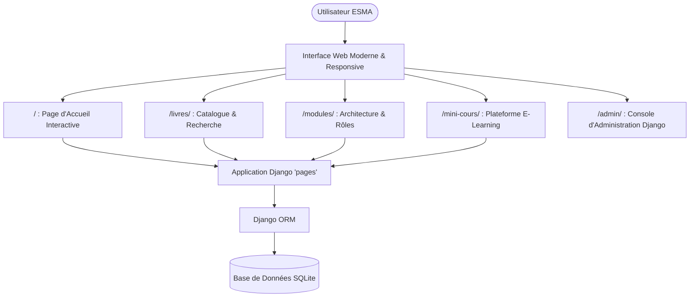
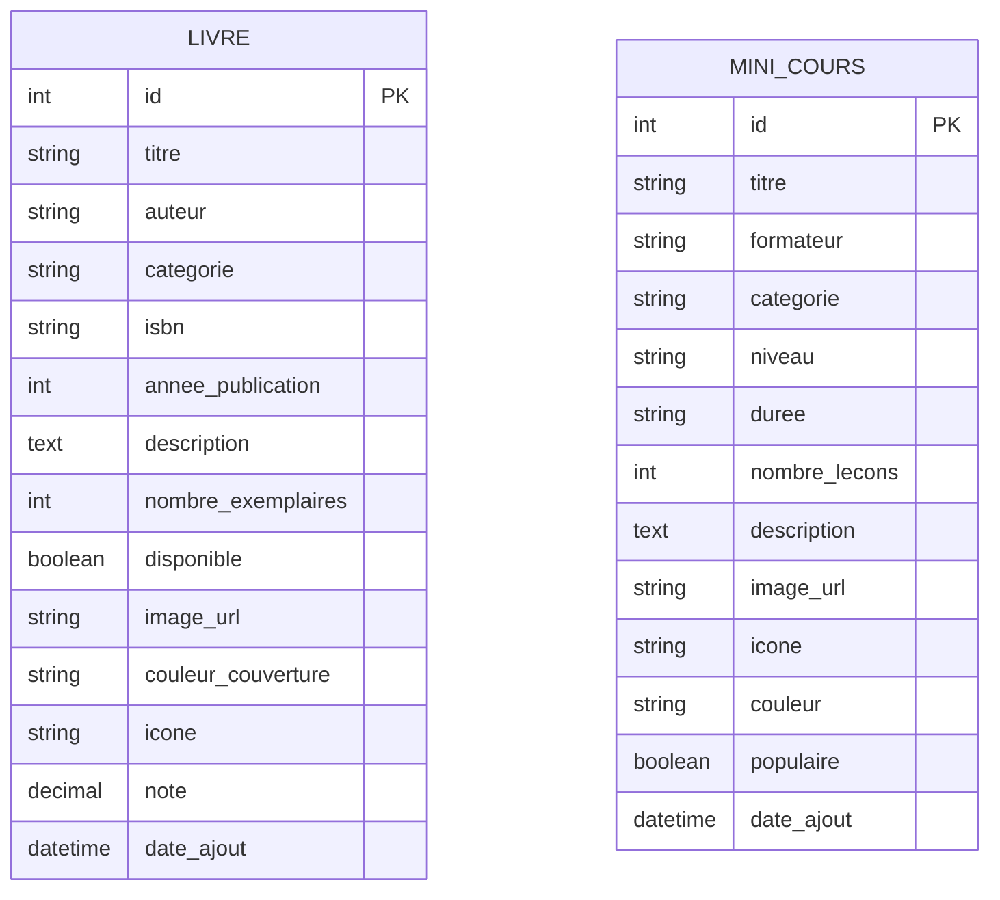

# Rapport de Présentation & d'Architecture : BiblioLearn

> [!NOTE]
> **Projet :** BiblioLearn &bull; Plateforme de Bibliothèque Universitaire &amp; E-Learning  
> **Établissement :** ESMA Marrakech  
> **Technologies :** Python 3.13, Django 5.2.19, Bootstrap 5.3.3, SQLite  
> **Date du rapport :** Novembre 2026  

---

## 1. Synthèse Exécutive

**BiblioLearn** est une solution web académique conçue pour moderniser la gestion documentaire et encourager l'auto-formation au sein du campus **ESMA Marrakech**. La plateforme centralise en une interface unique :
1. Le catalogue des ouvrages physiques et ressources documentaires.
2. Le système d'emprunt et de suivi des prêts pour les étudiants et enseignants.
3. Un espace de mini-cours interactifs (e-learning) pour le renforcement des compétences universitaires (méthodologie, développement, design, IA).
4. Une administration sécurisée pour les bibliothécaires et gestionnaires.



---

## 2. Architecture Technique & Structure du Code

Le projet respecte les standards de structuration Django (MTV : Modèle-Template-Vue) :

```
biblio_learn/
├── config/                  # Configuration du projet Django
│   ├── settings.py          # Paramètres (Apps, Templates, Base de données)
│   ├── urls.py              # Routage principal et inclusion des URLs de l'app
│   ├── asgi.py & wsgi.py    # Points d'entrée serveurs web
├── pages/                   # Application métier principale
│   ├── models.py            # Modèles de données (Livre, MiniCours)
│   ├── views.py             # Logique applicative & préparation des contextes
│   ├── urls.py              # Routage local (/livres/, /modules/, /mini-cours/)
│   ├── admin.py             # Enregistrement et configuration du back-office
│   ├── migrations/          # Migrations de schéma de la base de données
│   └── templates/pages/     # Templates spécifiques aux vues
│       ├── accueil.html     # Accueil vitrine avec Hero et statistiques
│       ├── livres.html      # Catalogue avec recherche et filtres dynamiques
│       ├── modules.html     # Présentation détaillée des 4 piliers fonctionnels
│       └── mini_cours.html  # Espace de cours vidéo et fiches pédagogiques
├── templates/
│   └── base.html            # Layout maître (Navigation Midnight, Footer ESMA)
├── db.sqlite3               # Base de données locale
└── manage.py                # CLI d'administration Django
```

---

## 3. Modélisation des Données (Schéma Entité-Association)

La couche de persistance s'appuie sur deux modèles majeurs définis dans [pages/models.py](file:///c:/Users/Hp/biblio_learn/pages/models.py) :



### Caractéristiques du modèle `Livre` :
- **Catégorisation normalisée :** Définie via une énumération (`TextChoices`) : *Informatique & Web, Management & Gestion, Design & Multimédia, Intelligence Artificielle, Marketing & Communication*.
- **Gestion du stock :** Champ `nombre_exemplaires` et booléen `disponible` pour piloter les autorisations de prêt.
- **Rendu visuel :** Support d'une image de couverture haute définition (`image_url`) avec dégradé de secours CSS (`couleur_couverture`).

### Caractéristiques du modèle `MiniCours` :
- **Niveaux pédagogiques :** Débutant, Intermédiaire, Avancé.
- **Domaines de formation :** Méthodologie & Recherche, Développement & Code, Management & Stratégie, Design & Créativité, Data & IA.
- **Métadonnées de suivi :** Durée estimée, volume horaire, nombre de leçons et mise en avant éditoriale (`populaire`).

---

## 4. Les 4 Piliers Fonctionnels

| Module | Rôle & Description | Route URL |
|---|---|---|
| **1. Catalogue d'Ouvrages** | Indexation des livres physiques et documents numériques avec recherche textuelle instantanée, filtrage par catégorie et vérification du stock en temps réel. | [`/livres/`](file:///c:/Users/Hp/biblio_learn/pages/templates/pages/livres.html) |
| **2. Comptes & Rôles (RBAC)** | Gestion des permissions différenciées adaptées aux profils : Étudiants, Enseignants, Bibliothécaires et Administrateurs. | [`/modules/`](file:///c:/Users/Hp/biblio_learn/pages/templates/pages/modules.html) &bull; [`/admin/`](file:///c:/Users/Hp/biblio_learn/pages/admin.py) |
| **3. Circulation des Emprunts** | Règles de prêt formalisées (14 jours pour les étudiants, 30 jours pour les enseignants), renouvellement en ligne et politique de réservation. | [`/modules/`](file:///c:/Users/Hp/biblio_learn/pages/templates/pages/modules.html) |
| **4. Mini-cours en Ligne** | Capsules d'auto-formation en vidéo et guides pratiques (rédaction de PFE, initiation Django, Figma UI/UX, IA générative). | [`/mini-cours/`](file:///c:/Users/Hp/biblio_learn/pages/templates/pages/mini_cours.html) |

---

## 5. Matrice des Rôles & Autorisations (RBAC)

> [!IMPORTANT]
> La gouvernance des accès est segmentée afin d'assurer l'intégrité des fonds documentaires :

| Fonctionnalité | Étudiant | Enseignant | Bibliothécaire | Administrateur |
|---|:---:|:---:|:---:|:---:|
| **Consultation du catalogue** | ✅ | ✅ | ✅ | ✅ |
| **Recherche & Filtres avancés** | ✅ | ✅ | ✅ | ✅ |
| **Quota d'emprunts simultanés** | 3 livres (14 j) | 6 livres (30 j) | Illimité (service) | Tous droits |
| **Accès aux Mini-cours** | ✅ Accès libre | ✅ Contributeur | ✅ Consultation | ✅ Modérateur |
| **Enregistrement des entrées/sorties** | ❌ | ❌ | ✅ | ✅ |
| **Ajout/Modification de livres** | ❌ | ❌ | ✅ | ✅ |
| **Gestion des utilisateurs & rôles** | ❌ | ❌ | ❌ | ✅ Superuser |

---

## 6. Identité Visuelle & Expérience Utilisateur (UI/UX)

La charte graphique a été conçue pour combiner élégance académique et modernité logicielle :
- **Palette Midnight & Royal Indigo :**
  - Fond sombre de navigation : `#0b0f19` (Verre dépoli avec bordure `#1e293b`).
  - Teinte primaire : `#4f46e5` (Indigo dynamique avec dégradés vers le violet `#8b5cf6`).
  - Accents fonctionnels : Émeraude (`#10b981`) pour les disponibilités, Ambre (`#f59e0b`) pour les alertes.
- **Typographie :** Combinaison de **Space Grotesk** pour les titres et **Plus Jakarta Sans** pour le texte courant.
- **Composants interactifs :**
  - Modales Bootstrap détaillées pour chaque livre et chaque mini-cours (avec résumé, ISBN, leçons, localisation en rayon).
  - Filtres dynamiques en JavaScript permettant de filtrer les résultats sans recharger la page.
  - Cartes avec survol interactif (zoom doux des images de couverture et élévation de l'ombre portée).

---

## 7. Inventaire des Données Initialisées

La base de données SQLite intègre actuellement un jeu d'essai réaliste adapté aux filières de l'ESMA :

### Livres référencés (6 titres) :
1. **Django 5 & Python Moderne : De Débutant à Expert** (Informatique & Web &bull; Note : 4.9)
2. **Management Stratégique des Organisations** (Management & Gestion &bull; Note : 4.8)
3. **UI/UX Design : Principes et Méthodes pour Interfaces Modernes** (Design & Multimédia &bull; Note : 4.9)
4. **Intelligence Artificielle & Deep Learning en Pratique** (Intelligence Artificielle &bull; Note : 4.9)
5. **Le Grand Guide du Marketing Digital & Growth Hacking** (Marketing & Communication &bull; Note : 4.7)
6. **Clean Architecture & Craftsmanship Logiciel** (Informatique & Web &bull; Note : 4.9)

### Mini-cours enregistrés (6 formations) :
1. **Méthodologie du PFE & Rédaction de Mémoire Universitaire** (Dr. Karim Alami &bull; 1h 30min)
2. **Initiation à Python & Django 5 pour le Web** (Prof. Youssef Berrada &bull; 2h 15min)
3. **Fondamentaux du UI/UX Design & Prototypage Figma** (Mme Salma Bennani &bull; 1h 10min)
4. **Recherche Documentaire & Gestion des Sources Académiques** (Équipe Bibliothèque &bull; 45 min)
5. **Management de Projet Agile avec Scrum & Kanban** (M. Omar Tazi &bull; 1h 45min)
6. **Introduction aux Outils d'IA Générative pour la Recherche** (Dr. Leila Mansour &bull; 1h 00min)

---

## 8. Recommandations & Perspectives d'Évolution

> [!TIP]
> Pour franchir une étape supplémentaire vers la production, les extensions suivantes sont recommandées :
> 1. **Modèle de transaction d'emprunt (`Emprunt`) :** Lier formellement un `User` et un `Livre` avec date d'emprunt, date d'échéance et statut de restitution.
> 2. **Espace Authentification Étudiant :** Formulaire de connexion/inscription front-end dédié aux étudiants pour consulter leur historique de prêt personnel.
> 3. **Export & Fiches PDF :** Génération automatique de reçus de prêt ou de fiches de lecture au format PDF.
> 4. **Notification par Email/SMS :** Automatisation des alertes 48h avant l'expiration d'un prêt d'ouvrage.
